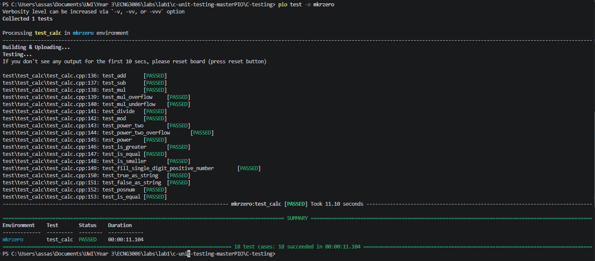

# Lab 1 – C Unit Testing with Unity

## Test results

All 18 test cases pass on the board:



## What was added

### `posnum` – verifying signed integers

[`lib/calc/calc.c`](lib/calc/calc.c)

```c
bool posnum(int x)
{
	return x > 0;
}
```

[`test/test_calc/test_calc.cpp`](test/test_calc/test_calc.cpp)

```c
void test_posnum()
{
	TEST_ASSERT_TRUE(posnum(10));
	TEST_ASSERT_FALSE(posnum(-10));
}
```

If `int` were unsigned, `-10` would wrap around to a large positive value, `posnum(-10)` would return TRUE, and the test would fail. The test passing confirms `int` is signed.

### `test_is_equal` – catching an 8-bit `int`

```c
void test_is_equal()
{
	TEST_ASSERT_TRUE(is_equal(10, 10));
	TEST_ASSERT_FALSE(is_equal(10, 9));
	TEST_ASSERT_FALSE(is_equal(300, 44));
	TEST_ASSERT_FALSE(is_equal(128, -128));
}
```

The two added assertions pick values that are different numbers but collide when stored in 8 bits:

| Assertion | Why it fails with an 8-bit `int` |
|---|---|
| `is_equal(300, 44)` | 300 doesn't fit in 8 bits; it truncates to 300 − 256 = **44**, so the values compare equal |
| `is_equal(128, -128)` | A signed 8-bit range is −128…127; 128 wraps to **−128**, so the values compare equal |

With a 16-bit (or 32-bit) `int` both pairs stay distinct and the assertions pass.

