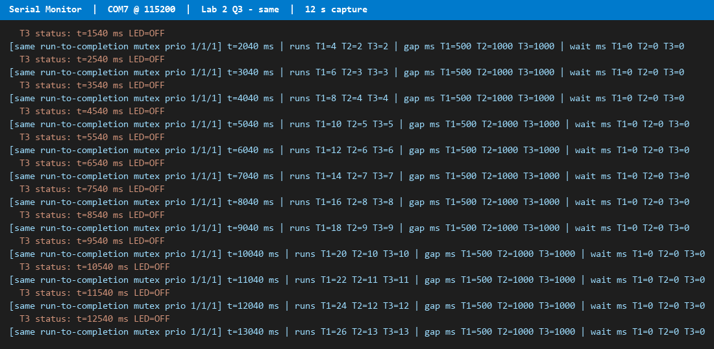
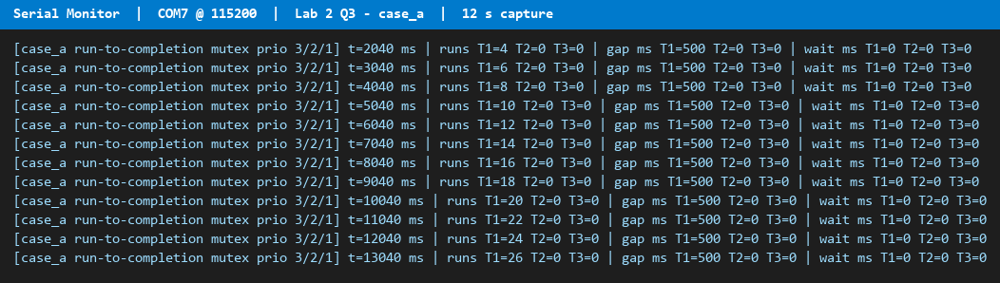
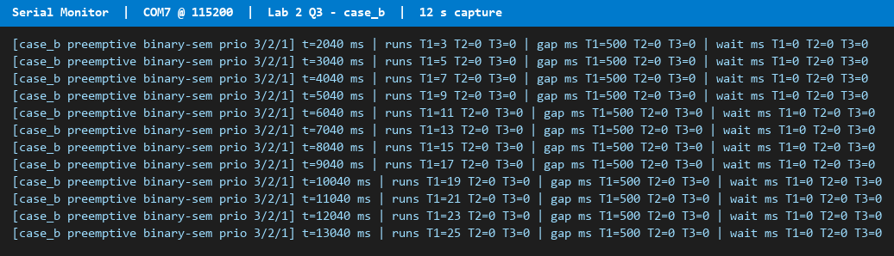
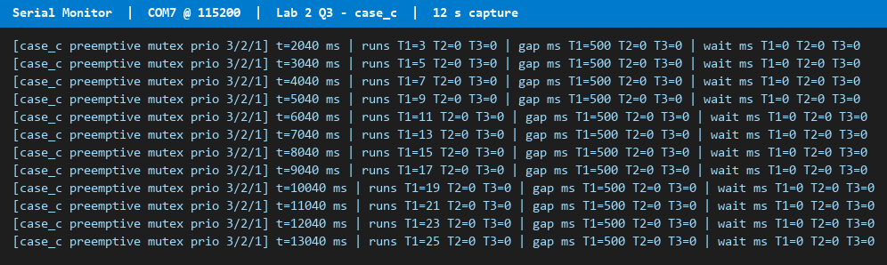

# Lab 2 Q3: relative task performance under four scheduler setups

Arduino MKR Zero (SAMD21) running FreeRTOS (briscoetech/FreeRTOS_SAMD21), built with PlatformIO.

The application is the Q2 one. Task 1 turns the LED on and actively waits 0.5 s before yielding. Task 2 turns the LED off and task-delays 1 s. Task 3 prints a status line and task-delays 1 s. All three share the LED pin through one lock. A MONITOR task was added for measurement only. It runs at the highest priority, never touches the LED and prints every task's counters once a second, so there is still evidence when a task never runs.

| Build env | Priorities T1/T2/T3 | Scheduler | Lock |
|---|---|---|---|
| `same` | 1 / 1 / 1 | run to completion (`configUSE_PREEMPTION 0`) | mutex |
| `case_a` | 3 / 2 / 1 | run to completion | mutex |
| `case_b` | 3 / 2 / 1 | preemptive | binary semaphore (no priority inheritance) |
| `case_c` | 3 / 2 / 1 | preemptive | mutex (priority inheritance) |

Each case is built from the same [src/main.c](src/main.c), with the settings coming from [platformio.ini](platformio.ini). The binaries are `firmware_<case>.bin`.

## Evidence (USB serial captures, 12 s each, in [evidence/](evidence/))

These are the last monitor lines of each capture, at t = 13 s:

| Case | Runs T1 / T2 / T3 | Worst gap between runs, ms (T1 / T2 / T3) | T3 status lines |
|---|---|---|---|
| same | 26 / 13 / 13 | 500 / 1000 / 1000 | yes, every second |
| a | 26 / **0 / 0** | 500 / - / - | **none** |
| b | 25 / **0 / 0** | 500 / - / - | **none** |
| c | 25 / **0 / 0** | 500 / - / - | **none** |

- **same:** every task runs at its intended rate. T1 runs every 0.5 s and T2 and T3 every 1 s. The LED is turned off once a second and T3 reports it.
- **a, b, c:** only T1 runs. Tasks 2 and 3 never run once, so the LED is never turned off and T3 never prints. They are starved.

The images below are the captured serial output for each case. Each one is drawn from the matching `.txt` file in [evidence/](evidence/).






## Which configuration performed better?

**All three tasks at the same priority, run to completion.** It is the only configuration in which every task does its job.

Task 1 never blocks. It busy-waits and then calls `taskYIELD()`, so it is always Ready. The FreeRTOS scheduler always runs the highest-priority Ready task, and `taskYIELD()` only hands the CPU to Ready tasks of **equal or higher** priority.

- **same:** T1's yield passes the CPU round-robin to T2 and T3 whenever their delay has expired, so all three share the CPU. The price of run to completion is that a task whose delay expires cannot interrupt T1. It waits until T1 yields, which can be up to 0.5 s. In this run, T1's 0.5 s cycle lined up with the 1 s delays, so no extra lateness was seen (gap = 1000 ms).
- **a) run to completion, T1 highest:** when T1 yields, the highest-priority Ready task is T1 itself, so T1 keeps running and T2 and T3 starve.
- **b) preemptive, T1 highest:** preemption only lets a *higher*-priority task take the CPU. Nothing outranks T1, so the result is the same as a).
- **c) preemptive with priority inheritance:** inheritance only helps when a high-priority task is blocked on a mutex held by a lower-priority task. It raises the holder's priority so it can finish and release the mutex. Here T2 and T3 never run, so they never hold the mutex and T1 never waits for it (wait = 0 ms in every case). The mutex has nothing to fix, and the result is identical to b).

Priority inheritance solves priority inversion, not starvation. For prioritised setups like a), b) and c) to work, a high-priority task must block (`vTaskDelay`, waiting on a queue or semaphore) rather than busy-wait. With equal priorities, a co-operative yield is enough to share the CPU.

## Reproduce

```
pio run -e same -t upload        # or case_a / case_b / case_c
pio device monitor               # board's USB serial port
```
